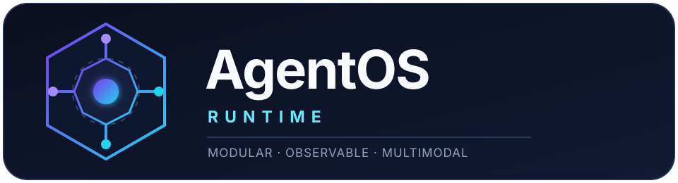
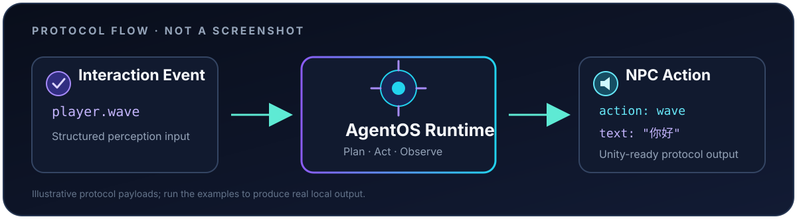

<p align="center">
  
</p>

# AgentOS Runtime

**A lightweight modular LLM Agent Runtime Framework<br>
with multimodal interaction support.**


AgentOS is a compact, typed, async-first runtime for learning and building production-style
LLM agents without hiding the execution model behind a large agent framework. Its ports and
adapters design keeps models, tools, memory, tracing, and multimodal interaction replaceable.

## Features

- Bounded asynchronous agent execution loop
- JSON-only planner decision protocol
- Pluggable model interface with deterministic fake and MiniLLM-Serve adapters
- Tool registry, executor, structured observations, and a safe calculator
- Abstract memory store with atomic JSON persistence
- Runtime events, JSON traces, latency profiling, cache, and timeout controls
- Native MiniLLM-Serve SSE streaming with token events and lifecycle management
- Sequential multi-tool workflows with automatic tool contracts and workflow events
- Trace-driven evaluation and performance benchmark reports
- Multimodal interaction adapters and privacy-conscious NPC memory
- Python 3.10+ typing, tests, Ruff, and mypy validation

## Architecture

```text
User / Unity / Multimodal Input
              |
              v
      Interaction Layer
              |
              v
        Agent Runtime
              |
              v
           Planner
              |
              v
       Model Interface
              |
              v
       Tool / Memory
              |
              v
     Trace / Evaluation
```

The core depends on abstractions. MiniLLM-Serve, JSON storage, tools, caches, and NPC protocol
objects remain adapters at the system boundary. See the detailed
[architecture guide](docs/architecture.md).

## Quick Start

```bash
python -m venv .venv
```

Activate the environment on Windows PowerShell:

```powershell
.venv\Scripts\Activate.ps1
```

Install the project and development tools:

```bash
python -m pip install -e ".[dev]"
```

Run the quality checks:

```bash
pytest
ruff check .
mypy src
mypy benchmarks
```

The calculator demo reads its MiniLLM endpoint from
[`configs/default.json`](configs/default.json). Start a compatible MiniLLM-Serve backend, then run:

```bash
python examples/calculator_agent.py
```

## Demo



The diagram above is a protocol illustration, not a captured or simulated runtime screenshot.

### Calculator Agent

Run [`examples/calculator_agent.py`](examples/calculator_agent.py) with MiniLLM-Serve available.

```text
Input
计算 123*456

Final Answer
56088
```

The complete flow is model decision → calculator call → observation → final answer → JSON trace.

### Spatial AI NPC

Run the protocol-only bridge or the full in-process spatial demo; neither requires Unity, a camera,
or a microphone.

```bash
python examples/npc_bridge_demo.py
python examples/spatial_agent_demo.py
```

```text
player.wave
    |
    v
AgentOS Runtime
    |
    v
NPC Action: wave + speech
```

See [`examples/README.md`](examples/README.md) for prerequisites and expected output.

## Benchmark

The current deterministic benchmark uses the 10 committed cases in
[`benchmarks/cases.json`](benchmarks/cases.json). These values come from the existing generated
benchmark report:

| Metric | Result |
| --- | ---: |
| Cases | 10 |
| Success Rate | 100% |
| Average Latency | 0.0897s |
| Average Model Calls | 2.00 |
| Average Tool Calls | 1.00 |

Run the evaluation and performance suites locally:

```bash
python -m benchmarks.evaluator
python -m benchmarks.performance
```

Benchmark results measure this deterministic local setup and are not model-quality claims. The
[benchmark guide](docs/benchmark.md) explains the metrics and generated reports.

## Spatial AI NPC Integration

AgentOS can serve as the reasoning backend for multimodal agents while remaining independent of
Unity and sensor SDKs:

```text
Vision / Speech / Interaction
            |
            v
      Perception Event
            |
            v
       AgentOS Runtime
            |
            v
      LLM + Tool Runtime
            |
            v
         NPC Action
```

Only structured interaction state is retained. Raw images, audio, faces, and biometric data are
outside the memory adapter's scope. Read the
[NPC integration guide](docs/npc_integration.md) for the protocol boundary.

## Documentation

- [Architecture](docs/architecture.md)
- [Getting Started](docs/getting_started.md)
- [Benchmark Framework](docs/benchmark.md)
- [Spatial AI NPC Integration](docs/npc_integration.md)
- [Design Principles](docs/design_principles.md)
- [Real MiniLLM Backend Integration](docs/real_backend.md)
- [Native Streaming Runtime](docs/streaming.md)
- [Multi Tool Workflow Runtime](docs/workflow.md)
- [Agent Evaluation Layer](docs/evaluation.md)
- [Trace Replay and Debugging](docs/replay.md)
- [v1.0.0 Release Notes](release/v1.0.0.md)

## Roadmap

- Additional streaming model backend adapters
- SQLite and vector-backed memory adapters
- Web search, code execution, and vision tools
- Multi-agent coordination experiments
- Live Unity transport implemented outside the core runtime

These are future directions, not features included in v1.0.0.

## License

AgentOS Runtime is released under the [MIT License](LICENSE).
