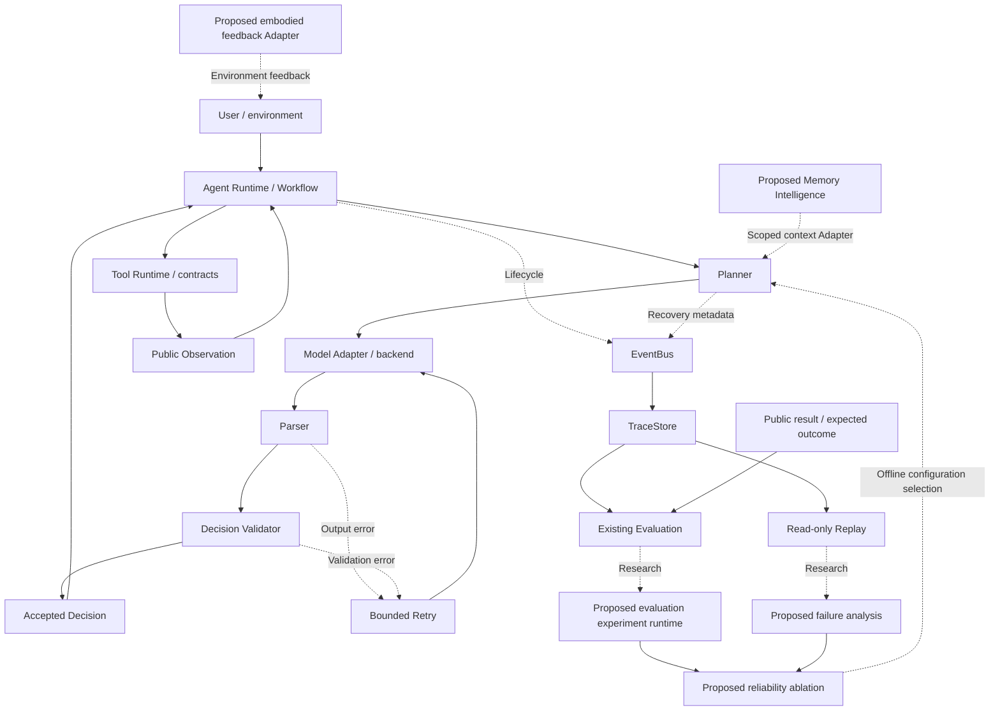

# AgentOS Research Direction

AgentOS research positioning: **Reliability-Oriented Runtime Kernel for LLM Agents**.

This document defines a research agenda, not a claim of demonstrated scientific novelty. It distinguishes the existing v1.x engineering foundation from proposed v2.x experiments and future capabilities. No runtime or API change is specified as already implemented here.

## 1. Research Motivation

LLM agents can choose tools, combine observations, and complete multi-step tasks, but plausible output is not necessarily executable or correct. Failure can occur at several boundaries: malformed decisions, invalid arguments, unsupported tools, premature completion, backend errors, and incorrect interpretation of tool results.

AgentOS development encountered concrete examples with a local Qwen backend: missing arguments, invented tool names, incompatible calculator parameters, and a final answer produced without the required tool evidence. These examples motivate runtime controls, but they are not a representative reliability study.

Runtime-level control is required because prompting alone cannot enforce every execution contract. The runtime must separate proposed actions from accepted decisions, preserve public execution evidence, bound recovery, and make failure measurable. Such controls complement model improvements; they do not guarantee factual correctness or safe execution of arbitrary tools.

The central research question is:

> Under a fixed model and task distribution, which runtime controls improve repeated-run task reliability, and at what latency, request, and recovery cost?

Reliability should include task correctness, contract adherence, completion consistency, and bounded failure handling—not merely valid JSON or a successful lifecycle event.

## 2. Related Work

The comparison below concerns the cited papers, rather than every later version of their software. Differences describe AgentOS's intended scope; they are not evidence of superiority.

### ReAct

ReAct interleaves model-generated reasoning and actions, allowing interaction with external information and environments to inform subsequent steps. It focuses on a reasoning-and-acting method and evaluates it on language and interactive tasks. [ReAct: Synergizing Reasoning and Acting in Language Models](https://arxiv.org/abs/2210.03629).

AgentOS shares the action–observation feedback pattern, but its research emphasis is the execution boundary: decision contracts, validation, bounded repair, and evidence-based evaluation. It does not require storing hidden reasoning. Public decisions and observations are sufficient for its intended runtime analysis; this is different from claiming to reproduce ReAct's prompting method or results.

### AIOS

AIOS separates agent applications from kernel services such as scheduling, context management, memory, storage, and access control. Its paper addresses serving agents and resource management. [AIOS: LLM Agent Operating System](https://arxiv.org/abs/2403.16971).

AgentOS uses a narrower kernel analogy: a lightweight execution and reliability boundary, not a host operating system or a general agent resource scheduler. The proposed focus is controlled experiments on failures and recovery. Multi-agent scheduling and OS-level isolation are not current AgentOS capabilities. The name and kernel terminology alone do not establish a new contribution relative to AIOS.

### MemGPT

MemGPT addresses limited context windows through virtual context management, moving information between memory tiers and using interrupts to coordinate control flow. Its evaluations include document analysis and multi-session conversation. [MemGPT: Towards LLMs as Operating Systems](https://arxiv.org/abs/2310.08560).

AgentOS currently has structured persistence, not MemGPT-style virtual context management. Its planned Memory Runtime asks whether scoped retrieval, provenance, conflict handling, and bounded context improve reliability without propagating incorrect memories. Memory is a later experimental variable, rather than the starting assumption that more retained context is always beneficial.

### tau-bench

tau-bench evaluates tool-agent-user interactions with simulated users, domain tools, and policies. It checks final database state against task goals and introduces pass^k to examine consistency across repeated trials. [tau-bench: A Benchmark for Tool-Agent-User Interaction in Real-World Domains](https://arxiv.org/abs/2406.12045).

AgentOS is a runtime and research testbed, not a replacement benchmark. Its current exact-answer and tool-sequence evaluation is narrower than domain-state verification. The research direction adopts the need for repeated trials and task-specific outcome checks. A future tau-bench integration would need a pinned benchmark version and compatible environment Adapter; it has not been implemented, and no tau-bench score is claimed.

## 3. AgentOS Positioning

**Reliability-Oriented Runtime Kernel for LLM Agents** means a small, backend-independent execution substrate that controls how model proposals become actions and exposes evidence for measuring that process.

The intended separation is:

- Model capability: produce candidate decisions through a replaceable Model Adapter.
- Runtime control: accept or reject decisions, execute declared tools, expose outcomes, and bound recovery.
- Research evaluation: judge public results against explicit task or environment expectations.

The kernel is an architectural concept, not a new operating-system kernel or a currently unified component named ReliabilityKernel. Existing mechanisms are distributed across Planner, Tool Runtime, events, and analysis modules.

Non-goals include universal autonomous correctness, a new foundation model, distributed scheduling, hidden-thought inspection, and an unrestricted code-execution sandbox. Embodied integration remains an external Adapter concern.

## 4. Contributions and Research Hypotheses

The following are contribution directions. Existing modules provide an engineering basis; publishable claims require comparative experiments, related-work coverage, and reproducible artifacts.

### Reliability Kernel

Existing foundation: Tool Contract prompts, JSON Parser, DecisionValidator, bounded Planner Retry, and serializable tool Observations.

Proposed contribution: a configurable control policy and failure model that separates syntax repair, contract validation, task-specific evidence checks, and recovery budgets.

Hypothesis: combining validation with bounded repair improves valid task completion over prompt-only and parser-only baselines at a measurable request and latency cost. Tests must also measure false rejection of otherwise correct decisions and failures that remain schema-valid.

### Trace-first Architecture

Existing foundation: EventBus, JsonTraceStore, RuntimeMetrics, and read-only TraceReplay.

Proposed contribution: a minimal public execution-evidence contract sufficient for identifying failure stages and comparing recovery policies, without persisting hidden reasoning or unnecessary sensitive content.

Hypothesis: structured phase and recovery evidence improves failure localization relative to terminal-status-only logs. Evaluate against labeled failures, including missing-event cases. Read-only replay must not be described as deterministic re-execution or as causal proof.

Current traces omit answer and observation bodies by default. Caller-supplied public results remain necessary for some evaluations; more logging must not silently remove privacy boundaries.

### Evaluation-driven Optimization

Existing foundation: benchmark cases, EvaluationMetrics, reports, latency profiling, cache, and runtime controls.

Proposed contribution: reproducible experiments that select control policies using held-out reliability and cost measurements rather than demonstration success alone.

Hypothesis: failure-aware policy choices can improve the reliability–cost trade-off over a fixed retry policy. Adaptive policies are future research, not an existing runtime feature.

### Experimental design

- Baselines: minimal JSON prompt; contract prompt; normalization; validation; bounded retry; full configuration. Use both cumulative additions and leave-one-component-out ablations to expose interactions.
- Tasks: valid single-tool tasks, multi-tool workflows, ambiguous inputs, malformed outputs, unknown tools, tool failures, and backend disruptions. Fault-injected fixtures test mechanisms; real-model trials test behavior. Report these separately.
- Controls: pin model revision, backend configuration, prompts, tools, datasets, generation settings, cache mode, and retry/step budgets. Record seeds when supported; a seed alone does not guarantee deterministic serving.
- Outcomes: task success, invalid accepted actions, tool selection, workflow completion, recovery success, repeated-run consistency, latency distribution, backend request counts, and resource usage when actually measured.
- Evidence: distinguish parser failures from semantic validation failures in future instrumentation. Current validation_failure_rate groups available PlannerOutputError evidence and cannot provide that separation.
- Analysis: repeat tasks, report sample counts and uncertainty, and use task-level paired comparisons or clustered resampling. Keep tuning and held-out evaluation separate; publish negative results and budget-exhausted runs.
- Safety: ablation of checks must use isolated, side-effect-free tools. Never disable production safeguards against real external systems just to obtain a baseline.

pass^k-style consistency is distinct from best-of-k/pass@k success: repeated success must not be presented as “at least one attempt succeeded.” If adopting an external metric, preserve its published definition and trial protocol.

## 5. Architecture Diagram

Solid execution edges describe existing logical mechanisms, not necessarily separate runtime objects. Dotted research edges are proposals; observability edges remain side-channel. Evaluation does not currently alter a running Agent. Memory retrieval and embodied execution feedback are not implied by the existing storage and NPC protocol Adapters.

## 6. Existing Implementation vs. Future Research

| Area | Existing v1.x implementation | Future research direction |
| --- | --- | --- |
| Execution | Agent Loop, Planner, Tool Runtime, sequential Workflow | Controlled policy comparisons, broader task constraints |
| Model boundary | FakeModel, MiniLLM, native streaming support | Cross-model reliability experiments with pinned settings |
| Contracts | Tool metadata, prompt injection of schemas, Parser, Validator | Failure taxonomy, false-rejection measurement, policy composition |
| Recovery | Configurable bounded output repair | Budget-aware or failure-specific recovery policies |
| Evidence | EventBus, JSON Trace, metrics, read-only Replay | Evidence completeness and labeled failure-localization evaluation |
| Evaluation | Exact-answer/tool-sequence metrics and benchmark reports | Environment-state checks, repeated trials, ablation platform |
| Memory | MemoryStore, JSON CRUD, NPC structured profile | Retrieval, ranking, lifecycle and experience consolidation |
| Embodiment | Perception/Interaction/NPCAction protocol Adapters | Real environment feedback and closed-loop embodied evaluation |

Calculator validation and deterministic benchmark fixtures establish that selected paths work. They do not establish robustness across domains, superiority to related systems, or a statistically validated research contribution. This document includes no new experimental results.

## 7. Research Roadmap

These are proposed research milestones, not released versions or date commitments.

| Milestone | Research scope | Exit evidence |
| --- | --- | --- |
| v2.0 Evaluation Runtime | Build an experiment layer over existing Evaluation: pinned configurations, trial identities, repeated runs and outcome checkers | Reproducible baseline artifacts, coverage and uncertainty reports; distinguish logical model phases from actual backend requests |
| v2.1 Failure Analysis | Define labeled parsing, contract, planning, tool, transport and evidence-gap failures | Failure-localization accuracy against reviewed labels; explicit unknown cases and recovered failures |
| v2.2 Reliability Ablation | Compare contracts, normalization, validation and retries under equal or explicitly reported budgets | Held-out task results, component interaction analysis, reliability–latency/request trade-offs and negative findings |
| v2.5 Memory Runtime | Evaluate scoped retrieval, ranking and conservative consolidation as reliability mechanisms | Memory-on/off studies, provenance checks, stale/conflicting-memory and isolation/deletion tests |
| v3 Embodied Agent | Integrate external perception/action feedback for Spatial AI NPC experiments | Simulated then real environment tasks; distinguish generated actions from confirmed execution; closed-loop recovery evidence |

The earlier [v2 Memory Architecture](v2_memory_architecture.md) proposes memory-focused v2.0.1–v2.0.6 increments. This research roadmap revises the priority: establish evaluation, failure analysis, and ablation first, then place that memory work under v2.5. Its component designs remain proposals; the previous document is not changed here, and neither numbering scheme implies implementation or release.

The near-term deliverable should be an evidence-backed reliability study, not more runtime features for their own sake. A convincing result explains which controls help, which fail, the tasks and models tested, and the cost of the improvement.

## References and Project Context

- [ReAct: Synergizing Reasoning and Acting in Language Models](https://arxiv.org/abs/2210.03629) — reasoning/action method.
- [AIOS: LLM Agent Operating System](https://arxiv.org/abs/2403.16971) — agent kernel services and resource management.
- [MemGPT: Towards LLMs as Operating Systems](https://arxiv.org/abs/2310.08560) — virtual context and memory-tier management.
- [tau-bench: A Benchmark for Tool-Agent-User Interaction in Real-World Domains](https://arxiv.org/abs/2406.12045) — interactive tool-use and repeated-trial reliability evaluation.
- [v1 Architecture Review](v1_architecture_review.md), [Evaluation](evaluation.md), [Replay](replay.md), and [v2 Memory Architecture](v2_memory_architecture.md) — repository implementation boundaries and prior design proposals.
