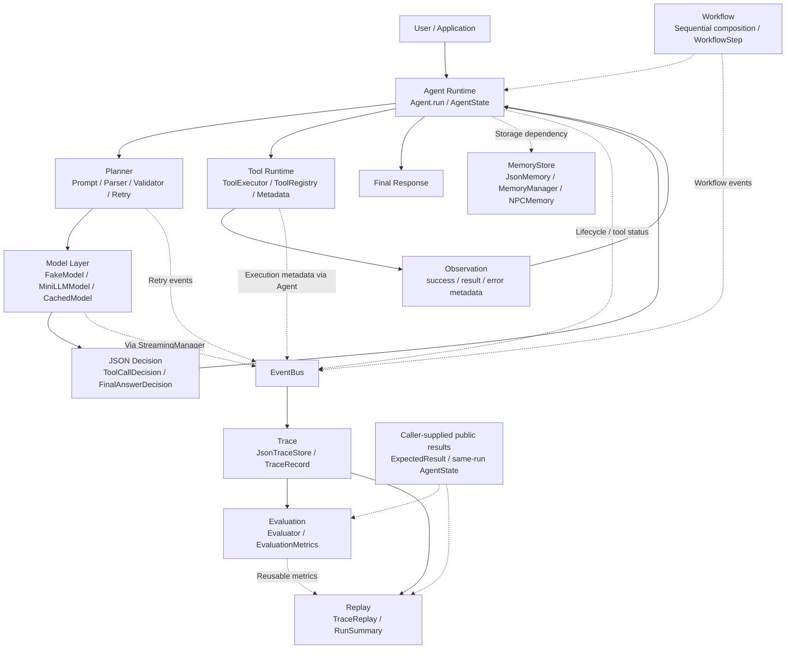
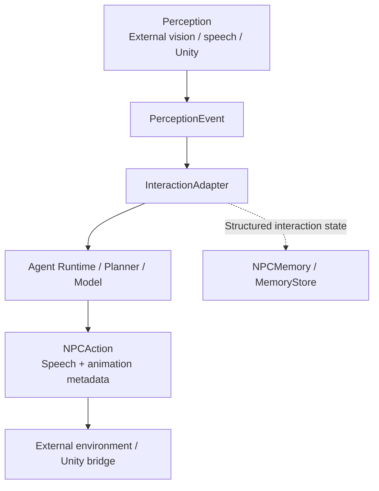

# AgentOS Runtime v1.x Architecture Review

本文复盘 AgentOS 从基础 Agent Loop 演进到仓库 `v1.7.0` 标签所覆盖的架构与能力，重点讨论模块边界、真实模型联调、可观测性、评估和调试。

版本说明：仓库已有 `v1.7.0` 演进标签，但当前 `pyproject.toml` 的包版本字段仍为 `1.0.0`，`CHANGELOG.md` 也主要记录 v1.0 发布。本文件使用功能里程碑描述 v1.x 演进，不调整发行元信息，也不将版本标签等同于已经发布到包索引的版本。

## 1. Project Overview

AgentOS 是一个 Modular LLM Agent Runtime Framework：用小规模、可组合的 Python 模块承载模型决策、工具执行、状态维护和运行分析。它提供 Agent 的运行基础设施，而业务任务、模型后端和外部交互环境由应用装配。

其当前定位包括：

- Backend independent：Planner 通过 Model 接口访问推理能力，Agent 不直接调用模型提供商的 HTTP API。
- Observable：运行生命周期、工具状态、修复尝试和流式输出可通过 EventBus 观察。
- Evaluatable：利用已有 Trace、期望结果和实际公开答案计算任务与执行指标。
- Debuggable：通过只读 Replay 检查历史执行步骤、失败位置和结果证据。

项目针对的是实践中常见的 Agent 工程问题：

| 问题 | AgentOS 的处理方式 | 当前边界 |
| --- | --- | --- |
| 输出不稳定 | JSON 归一化、契约提示、决策校验、有界修复重试 | 无法保证所有模型输出都可恢复 |
| 执行不透明 | 明确的 Decision、Observation 和生命周期事件 | 事件需要正确接线，内容并非全部持久化 |
| 难调试 | 关联 run_id 的 Trace、失败摘要与只读 Replay | 未记录的正文不能仅凭 Trace 恢复 |
| 难评估 | 统一指标、已有 benchmark cases 和 Markdown 报告 | 指标依赖完整证据与明确的期望结果 |

AgentOS 的价值在于把这些问题转化为可测试、可观察的边界，而不是宣称模型已经具备普遍可靠的自主执行能力。

## 2. Evolution Timeline

| 版本里程碑 | 主题 | 架构演进 |
| --- | --- | --- |
| v0.3 | Model Adapter | 引入可替换 Model 接口、确定性 FakeModel 和模型驱动 Planner |
| v0.4 | MiniLLM Backend | 将 HTTP 推理隔离为 MiniLLM Adapter，覆盖配置与错误转换 |
| v0.5 | Observability | 引入 EventBus、JSON Trace 与 streaming 接口基础 |
| v0.6 | E2E Demo | 通过 Calculator 示例串联模型决策、工具、Observation 和 Trace |
| v0.7 | Benchmark | 增加案例、执行指标和 Markdown 基准报告 |
| v0.8 | Performance | 增加延迟分析、进程内响应缓存、异步超时控制与性能报告 |
| v0.9 | NPC Adapter | 用感知事件、交互输入、NPC Action 和结构化玩家状态隔离空间应用 |
| v1.0 | Release | 整理文档、示例、开源主页和发布材料 |
| v1.1 | Real LLM | 对齐真实 MiniLLM-Serve HTTP 契约，建立真实后端验证入口 |
| v1.3 | Guardrails | 在输出归一化、工具契约提示和重试基础上，引入独立 DecisionValidator |
| v1.5 | Workflow | 复用 Agent Loop 组合多工具链，自动生成工具 metadata 并注入 Planner |
| v1.6 | Evaluation | 基于 Trace 与结果证据计算任务、工具、工作流、重试和校验指标 |
| v1.7 | Replay | 增加只读执行回放、RunSummary 和失败运行分析 |

这些标签按功能里程碑归纳。中间迭代还包含真实模型输出修复和原生 SSE streaming，它们共同支撑后续的 Workflow、Evaluation 与 Replay。

演进过程中的一个重要选择是保持 Agent 主循环稳定：新增能力主要通过 Planner、Adapter、事件订阅者和独立分析层组合进入系统。

## 3. Overall Architecture



图中执行链路与观察链路是两个不同职责的路径。模型输出先经过 Planner 转换和校验，再由 Agent 决定是否调用 Tool Runtime；模型不直接控制工具执行。

EventBus → Trace → Evaluation → Replay 表示运行证据如何被收集和分析。Evaluation 与 Replay 不参与主循环控制，Replay 也可以直接读取已有 Trace。Memory 是独立存储依赖，当前 Agent Loop 不自动检索或写入长期记忆。

## 4. Core Design Principles

### Ports & Adapters

运行协调依赖稳定边界：Planner 协议、Model 抽象、MemoryStore 抽象，以及 ToolExecutor 执行边界。Agent 当前直接使用 ToolExecutor 类进行工具编排；它并没有为每个内部对象再建立一套抽象接口。

外部系统被放在 Adapter 一侧：

- LLM provider：HTTP、SSE 和后端响应结构由 MiniLLMModel 与 HttpClient 处理。
- Unity：引擎或传输协议由外部应用负责，AgentOS 接收结构化交互事件。
- Database：MemoryStore 不携带文件路径或数据库实现；当前 Adapter 是 JsonMemory。

替换一个后端的前提是继续满足对应接口与契约。Backend independent 描述的是依赖边界，不代表所有提供商已经拥有现成适配器。

### Event Driven Observability

主要运行行为通过事件进入 EventBus，包括 Agent 生命周期、Planner 阶段、模型请求阶段、工具调用与执行状态。Retry、Workflow、Streaming 和 NPC Adapter 提供各自的扩展事件。

所有事件使用可 JSON 序列化的数据结构；run_id 用于运行关联，NPC 交互还使用 interaction_id。普通 handler 异常被隔离，Trace 写入失败不应决定 Agent 能否完成任务。

这项能力需要显式接线：Agent 的 event_bus 可以为空，Planner 重试事件也需要传入对应 EventBus。事件通知当前在调用协程内顺序执行，慢 handler 与 JSON 写入仍会影响延迟。

观察的是公开执行行为。核心 Trace 默认保留阶段、工具名、状态和错误元数据，省略完整 prompt、工具参数正文、Observation 结果正文和最终答案正文。Streaming token 与 NPC action 事件可能携带公开输出内容，应用需要自行选择哪些订阅者负责持久化。

### Contract First

模型和工具在两个方向上分别受到契约约束。

模型输出统一为 JSON Decision：

```json
{
  "type": "tool_call",
  "tool_name": "calculator",
  "arguments": {
    "expression": "123*456"
  }
}
```

最终回答使用：

```json
{
  "type": "final",
  "answer": "56088"
}
```

工具输入通过 metadata 与 schema 描述。工具名必须匹配，参数必须符合声明的输入结构；metadata 可来自显式声明或类型化 execute 签名。ModelPlanner.from_registry 将 Registry 中全部工具的契约快照同时用于 Prompt 和 Validator。

当前 schema 校验支持项目需要的 JSON Schema 子集。工具作者遇到不支持的注解或约束时需要明确调整契约。未声明工具契约的旧 Planner 保留兼容路径；语义约束如 required_tool 由应用显式配置。

### Failure Recovery

Planner 的恢复路径由三个组件组成：

1. Parser：提取 JSON，处理 Markdown 包裹和受支持的字段别名；拒绝非法或歧义输出。
2. Validator：检查已声明的工具契约、非空答案，以及配置了 required_tool 时的 Observation 依据。
3. Retry：捕获 PlannerOutputError，生成 repair prompt 并重新请求 Model，默认最多重试两次。

校验和重试发生在 Decision 返回 Agent 之前，错误决策不会作为已接受的动作写入 AgentState。网络错误直接向调用方报告。工具执行异常则由 ToolExecutor 转为失败 Observation，让 Planner 有机会在下一步修正调用或选择其他工具。

系统不会在观察层静默重放有副作用的工具。达到 max_steps 时，Agent 返回未完成状态；Workflow、Evaluation 和 Replay 对这一状态分别记录或分析。Guardrails 能约束已声明的行为规则，但不能证明所有任务理解、公式选择和事实性回答都正确。

## 5. Runtime Components

### Agent Core

Agent.run 是唯一执行循环，负责创建单次 AgentState、请求决策、执行工具、追加公开历史和判断终止。ToolCallDecision 后追加 Observation，FinalAnswerDecision 则结束运行。

max_steps 限制被接受的决策步数。一个 Planner 步骤内部可能发生额外修复请求，因此步数不等于真实后端请求数。状态属于单次 run，复杂应用能力通过外层组合进入。

### Planner

Planner 将状态转换为下一条决策。ModelPlanner 负责构造包含任务、公开历史、输出契约和可用工具的 prompt，再进行模型请求、解析、校验和修复。

声明了 required_tool 时，最终回答必须依据该工具最近一次成功 Observation，并与其结果一致。该策略适合当前 Calculator 验证，不等于通用事实验证或完整任务规划算法。

### Model Adapter

- FakeModel：提供确定性响应，支持离线测试和 benchmark。
- MiniLLMModel：通过 `/health` 获取服务模型名，使用 `/v1/chat/completions` 请求生成。
- CachedModel：对 generate 做进程内响应缓存，stream 则委托后端。
- StreamingManager：消费 Model.stream，向 EventBus 发送 stream.started、model.token、model.completed 和 stream.finished。

MiniLLMModel 的 stream 已使用真实 SSE，处理 UTF-8 分片、data 消息、完成 chunk 与 `[DONE]`。返回值是服务端文本 chunk，可以包含多个字符或 tokenizer token。

流式 Agent 示例在消费完整响应后才向现有 Planner 交付 JSON 文本。这样既能观察实时输出，又不会把尚未完成的 JSON 作为决策执行。

性能能力另包含 RuntimeMetrics、MemoryCache、TimeoutController 和性能 benchmark。缓存命中可减少后端请求，但核心 model.called 事件仍表示请求阶段；统计实际尝试时还需考虑缓存和重试事件。超时控制器需要在应用相应调用边界使用，并非所有工具自动具有超时限制。

### Tool Runtime

ToolRegistry 保存工具并拒绝重复名称。Tool Metadata 提供 name、description 和 input_schema。ToolExecutor 负责查找工具、校验参数、执行调用，并将错误转换为可序列化 Observation。

Calculator 使用 AST 白名单与表达式长度、节点数量、整数规模限制进行基本算术计算。这里的安全边界是该工具自身的输入限制；其他工具仍需要各自的权限与资源边界设计。

### Workflow

Workflow 组合 Agent、ModelPlanner 和既有 ToolExecutor，实现：

```text
Planner → Tool A → Observation → Planner → Tool B → Observation → Final
```

它复用 Agent Loop，输出包含成功与失败尝试的 WorkflowStep 快照，并提供 workflow.started、workflow.step.*、workflow.completed 和 workflow.failed 事件。

当前工作流是由模型逐步选择动作的顺序工具链。独立 DAG 调度、分布式执行和并行工具编排尚未实现。事件来源绑定支持区分共享 EventBus 上的并发及嵌套运行；共享模型和工具本身的并发安全仍由其 Adapter 负责。

### Memory

MemoryStore 是 Storage Interface，包含 save、get、list、query 和 delete。JsonMemory 使用 version/items 格式，支持 ID 更新、类型过滤、唯一临时文件与原子替换；锁保护单进程内的多线程访问。

MemoryManager 封装结构化记忆创建与查询。NPCMemory 使用固定的玩家交互状态字段。当前基础 query 是类型过滤，不是语义检索；Agent Loop 也不会自动将存储内容注入 prompt。

### Evaluation

Evaluator 复用 TraceRecord、JsonTraceStore、RuntimeMetrics 与已有 benchmark case 结构，输出 EvaluationResult 和 Markdown 报告。指标包括：

- task_success_rate：完整运行中的精确答案匹配率，并报告已评估任务覆盖数。
- tool_selection_accuracy：期望工具序列与实际调用的顺序位置匹配率，惩罚缺失和额外调用。
- workflow_completion_rate：具有 Workflow 事件的运行中的完成比例。
- average_latency：已有 RuntimeMetrics 的平均总延迟。
- retry_rate：出现修复重试的 run 比例。
- validation_failure_rate：有公开校验失败证据的 run 比例，恢复成功后仍保留这项记录。

最终答案由调用方提供；Trace 的成功状态本身不能证明答案正确。缺失期望或实际结果的指标显示 N/A。离线 benchmark 的确定性成功率只描述对应案例和 FakeModel 设置，不能代替真实模型质量评估。

### Replay

TraceReplay 通过 run_id、TraceRecord 或 JSON 文件读取历史，整理模型调用、Planner 决策、工具执行、Observation、最终回答和失败步骤。RunSummary 提供延迟、调用次数、重试、校验失败、状态与结果摘要，并复用 EvaluationMetrics。

Replay 是只读调试：不会重新调用模型或工具，也不会改写 Trace。缺失的正文标记为 unavailable；调用方可以提供同一 run 的 AgentState 补齐公开内容，Replay 会检查已有元数据的冲突。

## 6. Real MiniLLM Integration

实际推理边界为：

```text
AgentOS ModelPlanner
        ↓
MiniLLMModel
        ↓
MiniLLM-Serve HTTP / SSE API
        ↓
Qwen/Qwen2.5-1.5B-Instruct
```

AgentOS 通过 GET `/health` 发现当前模型，并将 Planner prompt 作为 user message 发送到 POST `/v1/chat/completions`。普通生成读取 choices[0].message.content；原生 streaming 设置 stream=true 并读取 choices[0].delta.content。

真实 Calculator 验证已经完成以下链路：

```text
输入：计算 123*456
工具决策：calculator(expression="123*456")
Observation：56088
最终答案：56088
```

真实联调暴露过缺失 arguments、错误工具名、非契约参数，以及绕过工具直接结束等问题。Parser、工具契约提示、Retry 和 Validator 分别处理这些不同边界，而不是将所有问题混为 JSON 修复。

开发期间，在加入决策 Guardrails 后，同一计算任务的连续 10 次真实调用均完成 Calculator 闭环并返回 56088。原生 SSE 示例也验证了流式工具决策与最终答案。这是固定任务、特定本地后端配置下的样本验证，不是面向未知任务的通用成功率承诺，本次文档工作没有重新执行推理测试。

服务启动、Qwen 加载与硬件配置属于 MiniLLM-Serve。AgentOS 不自动启动服务。配置模板不含 API Key，本地配置文件由 Git 忽略。

运行入口与故障说明见 [Real Backend](real_backend.md) 和 [Native Streaming](streaming.md)。

## 7. Spatial AI NPC Extension

AgentOS 可以作为 Embodied Agent Runtime 的推理与行为编排后端。目前已经实现协议 Adapter 边界，视觉、语音感知与 Unity 场景控制由外部系统提供。



支持的感知事件包括 player.detected、player.wave、player.look 和 player.speech。InteractionAdapter 将其转换为 Agent 输入，再把公开最终答案转为 NPCAction。

NPCMemory 保存玩家 ID、交互次数、最近动作和关系等级，不将原始图片、音频或生物特征复制到玩家 Profile。基础 MemoryStore 仍允许应用存储任意结构化内容，因此数据选择与隐私政策需要在应用边界执行。

当前 NPC 示例验证的是结构化事件到动作的流程。真实传感器识别、动作执行反馈和 Unity 网络传输还需要关联项目接入；物理环境中的闭环控制、导航或机器人执行能力尚未由这些 Adapter 提供。

详细协议见 [Spatial AI NPC Integration](npc_integration.md)。

## 8. Future Roadmap

v2.0 的拟定方向是 Memory Intelligence：在已有 Storage Interface 之上，让记忆成为可选择、可验证的任务上下文。以下内容均为未来计划。

| 方向 | 计划能力 | 需要回答的工程问题 |
| --- | --- | --- |
| Retrieval | 按任务检索相关结构化记忆、事件或经历 | 哪些内容相关，来源与引用如何保留，检索预算如何限制 |
| Ranking | 根据相关性、时间与任务约束排序候选记忆 | 如何避免过期或低质量记忆挤占上下文，如何评估排序收益 |
| Long-term memory | 引入保留、更新、失效和应用授权策略 | 存储哪些事实、谁能修改、冲突如何处理、何时删除 |
| Experience consolidation | 从已验证的公开执行经历提炼可复用经验 | 如何保留证据，怎样避免把模型错误固化为长期知识 |

实现方向应延续 v1.x 的边界：

- 将检索与排序放在独立接口及应用装配层，保持 Agent Loop 稳定。
- 让 JSON、未来 SQLite 或向量存储成为可替换 Adapter，而非核心必需依赖。
- 对记忆访问记录可观察的元数据，继续避免保存隐藏推理与不必要的敏感信息。
- 用现有 Evaluation 对比记忆启用前后的任务成功率、工具选择、延迟和修复成本。
- 让 Replay 展示可追溯的公开记忆证据，而不是用记忆内容替代真实执行记录。

当前已经实现的基础是结构化存储、类型查询、NPC Profile、Trace、Evaluation 和 Replay。语义 Retrieval、Ranking、自动长期记忆管理与 Experience consolidation 尚未实现；它们需要独立设计、案例与验证，不能仅通过新增存储后端宣称完成。

相关设计基础见 [Design Principles](design_principles.md)、[Workflow](workflow.md)、[Evaluation](evaluation.md) 和 [Replay](replay.md)。
