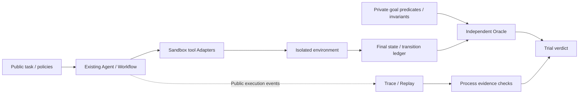
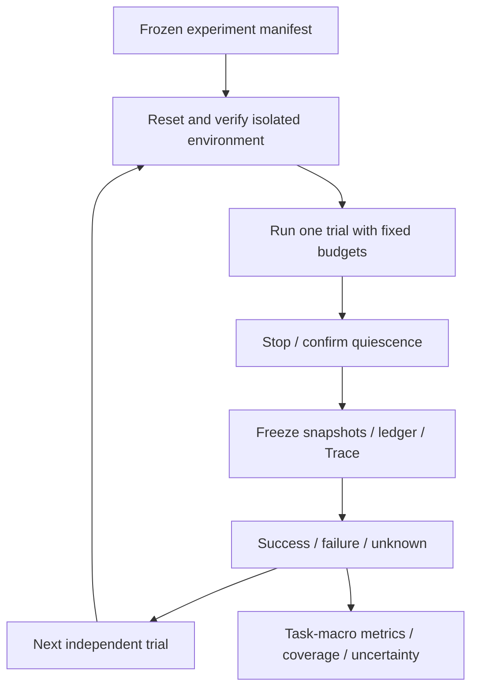

# AgentOS v2 Benchmark Specification

状态：未来协议设计，尚未实现。本文将 [v2 Evaluation Architecture](v2_evaluation_architecture.md) 细化为可复现的基准协议；不改变现有代码、API、Trace 格式或 v1 指标语义。

## 1. Benchmark Motivation

AgentOS 的研究定位是 Reliability-Oriented Runtime Kernel for LLM Agents。Benchmark 应回答：Agent 是否完成实际目标、是否遵守执行约束，以及 Runtime 控制是否在可接受成本下改善可靠性。

现有 v1 基础包括文本匹配、工具序列比较、Workflow 状态、重试/校验统计、延迟和 Replay。它不是纯文本评测，但尚未提供独立环境终态 Oracle、多次运行一致性协议或系统化消融。

τ-bench 为工具与用户交互任务提供状态评价和 repeated-trial reliability 思路。本协议借鉴这些原则，而非复制其数据、声称已接入其环境或宣称结果可直接比较。[τ-bench 原始论文](https://arxiv.org/html/2406.12045v1)。

## 2. State-based Evaluation Philosophy

主要评价对象是环境状态，而不是 Agent 自报成功。



成功条件：合法完成终止、终态目标成立、强制过程约束成立。不同合法工具路径可成功；文本正确但状态错误不能成功；先违规再恢复终态也不能抹除违规。

公开政策与私有断言分离。Agent 可见输入、允许工具和业务政策，但不可见隐藏目标状态、Oracle 结果或参考轨迹。评测规则不得要求未向 Agent 公开的行为政策。

任务目标应可由确定性规则判断；文本输出仅在任务明确要求提供某项信息时作为附加检查，不默认采用 LLM-as-judge。未来若使用模型裁判，必须独立报告其版本、误差与人工复核，不替代可信状态证据。

## 3. Task Schema

以下是拟定的 `agentos-state-benchmark/1` 协议，不是当前 BenchmarkCase 的新字段。

| 字段 | 要求 |
| --- | --- |
| schema_version、dataset_version、task_id | 必填；任务 ID 在数据集版本内唯一 |
| split、category、tags | 必填；split 为 development 或 held_out，标签可为空 |
| public_input、public_policy_ref | 必填；后者可为 null，但引用存在时必须版本固定 |
| environment | 必填；Adapter ID、版本、初态 fixture 引用与内容摘要 |
| allowed_tools | 必填；工具名与契约版本固定，不允许动态扩权 |
| goal_predicates | 必填、非空；明确终态路径、操作符、类型化预期值 |
| invariants | 必填、可为空；明确适用阶段与可信检查器 ID |
| budgets | 必填；accepted_steps、backend_requests、tool_attempts、wall_time_seconds 的正数上限 |
| fault_plan | 必填；无故障时 null，其他情况下含触发条件与恢复属性 |
| oracle_version | 必填；决定判定语义，不能在评测中途变更 |
| output_checks | 必填、可为空；任务要求的信息检查，不以文本替代状态 |

示例是设计 fixture，项目当前没有库存环境或这些工具：

```json
{
  "schema_version": "agentos-state-benchmark/1",
  "dataset_version": "prototype-1",
  "task_id": "stock_transfer_001",
  "split": "development",
  "category": "multi_step",
  "tags": ["inventory"],
  "public_input": "按公开调拨政策，将 A 的 3 个 widget 调到 B",
  "public_policy_ref": "policies/inventory-v1.json",
  "environment": {
    "adapter": "inventory",
    "version": "1",
    "initial_state_ref": "fixtures/stock_transfer_001.json",
    "initial_state_digest": "<fixture content digest>"
  },
  "allowed_tools": [
    {"name": "inspect_stock", "contract_version": "1"},
    {"name": "transfer_stock", "contract_version": "1"}
  ],
  "goal_predicates": [
    {"path": "/stock/A/widget", "operator": "equals", "value": 7},
    {"path": "/stock/B/widget", "operator": "equals", "value": 5}
  ],
  "invariants": [
    {"checker": "stock_nonnegative_v1", "scope": "every_transition"},
    {"checker": "stock_conserved_v1", "scope": "every_transition"}
  ],
  "budgets": {
    "accepted_steps": 10,
    "backend_requests": 20,
    "tool_attempts": 10,
    "wall_time_seconds": 120
  },
  "fault_plan": null,
  "oracle_version": "inventory-oracle/1",
  "output_checks": []
}
```

示例摘要是占位符，发布数据集必须填入真实摘要。初态 fixture 中 A=10、B=2；公有政策必须说明必要前置步骤。任务路径采用 JSON Pointer；缺失路径、错误类型、非法操作符是无效 fixture，不是 Agent 失败。

基础操作符拟限定 equals、contains、unchanged；复杂约束引用受信任、版本化检查器，不执行任务文件中的任意代码。浮点容差、数组顺序与无关字段排除必须显式声明。

发布前人工检查可解性、政策一致性及至少一条合法参考执行。参考轨迹只用于 fixture 验证，不作为唯一允许路径。相同模板或初态家族跨 split 的泄漏应在数据集清单中检查。

## 4. Environment Assumptions

初期环境为单进程、顺序执行、合成数据、无真实外部副作用的测试 Adapter。

- 每个 trial 独立 reset；初态摘要必须符合 fixture，不继承其他 trial 的状态、会话、缓存或 Memory。
- 工具声明读/写行为、参数契约、错误语义、幂等性和提交点。调用失败不必等于没有写入；ledger 必须记录是否提交或结果是否未知。
- snapshot 返回不可变状态投影与 revision；所有变化由环境记录，不能依赖 Agent 自报或仅依赖终态文本。
- 确定性环境相同输入产生相同结果；随机环境需固定 RNG 与故障计划，单独分层报告。
- 超时后确认操作停止再评分；无法确认静止状态标记 infrastructure/evidence error，禁止假装已完成清理。
- Oracle 与 Agent 隔离，无真实密钥、私人数据、网络写操作或隐藏思维链。

多轮用户模拟、并行工具和真实 Unity 环境属于后续协议扩展。若引入用户模拟器，固定其模型、版本、行为政策和独立随机源；不得把现有单次 Agent.run 宣称为完整多轮用户环境。

## 5. Task Categories

| 类别 | 目标 | 典型故障/验收 |
| --- | --- | --- |
| single_action | 一次有状态修改 | 错误对象或数量；文本成功但未提交 |
| multi_step | 有依赖的查询与修改 | 跳过公开要求的前置步骤、错误状态推断 |
| contract_stress | 格式与参数遵循 | 未知工具、缺字段、类型错误；区分提议与执行 |
| policy_constraint | 状态及授权边界 | schema 正确但越权、超库存、破坏保护字段 |
| recoverable_fault | 已声明可恢复故障 | 故障实际触发后正确恢复，不重复副作用 |
| terminal_fault | 不可恢复情况 | 明确安全停止；按任务目标定义正确终态，不要求虚假成功 |
| duplicate_action | 重复/超时后的幂等风险 | 双重提交、错误重试已提交动作 |
| observation_mismatch | 不完整或矛盾公开结果 | 不猜测已执行；核实或安全退出 |
| regression_text | 现有 Calculator/文本回归 | 保持 v1 语义，单独报告，不混入有状态主榜 |

任务可有多个标签，但主类别唯一。纯故障注入和真实模型自然失败分别统计；任务数量和类别配额在数据集发布清单中冻结，而不是根据模型表现挑选。

## 6. Trial Protocol: pass@1 and pass^k

一次 trial 是从独立初态开始、在预算内运行到终止的一次完整任务尝试。内部 Planner retry 属于该 trial 的成本，不算额外独立试验。不得从多次运行中选择最优答案计算 pass@1。



默认设计 profile：每个任务、每个配置 n=10 次，报告 k=1、2、4、8；这是 AgentOS 提案，不是 τ-bench 默认设置。实际清单可声明其他 n/k，但 n 必须不小于最大 k，且提前冻结。

对 M 个具有 n 次完整评分的任务，任务 i 有 c_i 次成功：

```text
pass@1 = (1/M) * sum_i(c_i / n)
pass^k = (1/M) * sum_i[choose(c_i, k) / choose(n, k)]
choose(c_i, k) = 0 when c_i < k
```

pass@1 衡量单次完整尝试成功概率；pass^k 衡量 k 次均成功的一致性，而不是至少一次成功。作为对照，pass@k 的 best-of-k 含义对应 `1 - choose(n-c_i,k)/choose(n,k)`，不作为本协议主要可靠性指标。τ-bench 原文给出上述估计方法；AgentOS 的任务集、成功规则和环境不同，不能将同名指标当作同一基准成绩。[τ-bench metric definition](https://arxiv.org/html/2406.12045v1#S3)。

数学解释依赖 trials 同分布且近似独立。后端漂移、共享缓存和会话记忆破坏这一前提：固定配置，关闭跨 trial cache，随机化运行顺序并记录服务异常。温度为 0 的重复执行可能只是确定性重复；明确报告，不人为制造随机性来声称泛化。

Trial verdict：

- success：completed、目标和所有强制约束均满足。
- failure：可评分的目标/约束失败，或 Agent/backend 错误、超时、步数/请求预算耗尽。可独立证明失败时不因次要日志缺失改成 unknown。
- unknown：无法可靠判定，例如 Oracle 损坏、初态无法验证或关键证据缺失。

主 complete-panel 指标只使用固定 n 次均可评分的任务，展示排除任务与原因；不得悄悄以新的成功 trial 替换 unknown。另对所有计划任务报告保守下界（unknown 按失败）与上界（unknown 按成功），按同样组合公式计算，说明它们是界限而非成功估计。协议允许技术重跑时保留原 trial，单独发布 rerun sensitivity，不覆盖原结果。

按任务等权聚合；另报告类别与 domain 宏平均，不能混淆加权方式。报告 95% task-cluster bootstrap 区间、重采样规则和样本量；这是有限任务集的不确定性描述，不是通用部署保证。

## 7. Reliability Metrics

| 指标 | 分母及证据 |
| --- | --- |
| pass@1、pass^k | 见 §6；基于状态、过程及终止 verdict |
| Goal attainment | 可验证终态中目标满足的比例，独立于终止状态 |
| Process compliance | 有完整强制约束证据的 trials 中无违规比例 |
| Tool selection validity | 有可判定上下文的选择中符合允许工具/前置规则的比例 |
| Argument contract validity | 已观测候选调用中符合 schema 的比例 |
| Argument semantic validity | 领域可判定调用中满足参数语义/对象条件的比例 |
| Recovery success | 实际触发预声明可恢复故障的可评分 trials 中最终成功比例 |
| Unsafe execution | 已执行调用中产生禁止迁移的比例，另报违规 trial 比例 |
| Recovery burden | 重试次数与修复请求、首次错误至恢复耗时 |
| Efficiency | 总延迟 mean/p95、实际 HTTP 请求、工具尝试、已提交写操作、实际可得 token 用量 |
| Evidence coverage | 可评分 trials、完整 ledger 和具备参数判定证据的数量/计划数量 |

提议、验证器拒绝、工具尝试、执行成功和写入提交是不同阶段。不得用 tool.called 次数作为全部候选决策数，或用 model.called 作为真实 HTTP 请求次数；cache 与 repair 可能改变关系。

分母为零或证据不可得时标记 N/A。同时提供 numerator、denominator 和 coverage；恢复成功不抹除曾经的验证/工具失败。计时以未来 harness 单调时钟为主，Trace 时间用于阶段辅助分析，缺失阶段不能补造时长。

## 8. Failure Taxonomy Based on Trace Replay

Replay 是只读证据导航，不重新运行工具，也不推断模型隐藏理由。失败分类依据事件、环境 ledger 和 Oracle 的可观察事实。

| 类别 | 需要的证据 | 当前可见性 |
| --- | --- | --- |
| parsing | 明确 JSON 提取/解析失败阶段 | 现有 PlannerOutputError 可能与校验合并；细分需未来证据 |
| contract | 工具名/参数 schema 拒绝原因 | 工具错误及 retry 元数据可提供部分证据 |
| semantic_validation | 参数/决策违反领域前置规则 | 未来领域 ledger/检查器；不能只凭 TypeError 判断 |
| planning_outcome | 无其他已知主因但目标未达成、提前结束 | 需要终态 Oracle；名称不表示知道模型内在原因 |
| tool_execution | 工具内部失败或提交状态未知 | Observation/Trace 错误 metadata；提交需 ledger |
| transport | HTTP 超时、不可达、响应错误 | 已有 Adapter 异常/终止证据，细分依赖接线 |
| budget | 步数、时间或请求额度耗尽 | 当前部分可见；新增预算依赖未来 harness |
| policy_violation | 未授权动作或非法中间状态 | 未来可信过程 Oracle |
| evaluation_infrastructure | reset、Oracle、采集或清理错误 | harness 分类，不应归责给 Agent |
| evidence_gap | 证据不足或来源冲突 | Replay unavailable 状态及未来完整性检查 |

FailureAnnotation 拟含 trial_id、run_id、event/attempt 引用、类别、stage、observed_fact、recovered、最终 verdict 和人工复核状态。保留多个错误及顺序，不只记最后异常；primary_failure 仅在预定义规则或复核证据支持时填写，否则 unknown。

审核标签先依据公开证据，再由独立复核处理歧义。标签质量需报告一致性与 unknown 数量。恢复率依据实际故障发生记录，不能以 fault_plan 存在代替“已经触发”。

## 9. Ablation Experiment Design

拟设最小结构化提示基线、契约提示、Parser、Validator、bounded Retry 和完整组合。采用累加及 leave-one-component-out；组件依赖不能满足时声明配置不可用，而不是偷偷启用替代机制。开关装配属于未来设计，当前代码不因此具有所有消融模式。

1. 冻结模型/后端 revision、数据集、公开政策、工具契约、Oracle、生成设置和 prompt 版本。
2. 开发集调参后冻结配置；held_out 任务家族不用于选择 retry 次数、Validator 规则或提示示例。
3. 保持 accepted_steps、HTTP request、工具和 wall-time 预算可比较。分别报告统一预算与策略自然成本，不能把额外 retry 请求隐藏。
4. 配置按任务配对，随机化顺序；模型支持 seed 时配对记录，但不能保证输出确定性。
5. 同一预声明故障机制用于各配置；触发依赖工具路径时报告触发率，避免只比较成功触发的不同任务子集。
6. 报告成功率差值、pass^k、成本、错误接受/拒绝和任务级区间。有限样本、后端漂移与配置交互作为研究限制。
7. 关闭保护只在合成隔离环境进行；不取消真实工具的权限检查。安全基础边界不是实验中随意移除的组件。

不得通过修改 Oracle、减少困难任务、隐去 timeout 或取 best-of-n 宣称 Runtime 提升可靠性。FakeModel/fault injection 证明机制行为，真实模型重复实验提供可靠性证据，两者分开报告。

## 10. Mapping to Existing AgentOS Components

| 现有组件（已实现） | 可复用角色 | Future benchmark design（未实现） |
| --- | --- | --- |
| Agent / AgentState | 单次执行、公开状态与终止 | Trial Controller、独立环境、试验身份映射 |
| Workflow | 顺序多工具链和步骤证据 | 状态目标、合法替代路径及阶段约束判定 |
| Model / MiniLLM / FakeModel | 模型替换、真实或确定性请求 | 模型清单、真实请求 ledger、重复采样协议 |
| ToolRegistry / Metadata / ToolExecutor | 契约与执行边界 | 沙箱领域工具、提交状态及语义参数证据 |
| Parser / Validator / Retry | 格式修复、验证、有界恢复 | 可比较配置与阶段级 failure annotation |
| EventBus / JsonTraceStore | 生命周期记录与运行关联 | 独立 snapshots/ledger evidence bundle |
| RuntimeMetrics | 已有事件延迟分析 | harness 单调计时、预算成本与覆盖检查 |
| Evaluator / report | v1 文本和序列回归指标 | 独立 StateOracle、版本化 TrialResult、pass^k 汇总 |
| TraceReplay / RunSummary | 只读步骤、错误与 unavailable 内容 | trial 证据引用和复核标签，非重执行引擎 |
| Benchmark cases | 既有离线回归样本 | versioned state tasks、split 与发布验证 |

未来产物建议为 benchmark_manifest.json、trial_results.json、benchmark_report.md 和按 trial 隔离的证据目录。清单记录任务/类别数量、n/k、预算、seed/cache 设置、摘要及软件版本；报告必须展示缺失证据和排除项。

发布门槛是 fixture/Oracle 可验证、隔离与重置通过、成功/失败/unknown 分母正确、公式有手工验证、Replay 引用完整、合成数据与隐私检查通过。本文没有新建这些产物、任务或运行结果。

相关基础：[Research Direction](research_direction.md)、[v2 Evaluation Architecture](v2_evaluation_architecture.md)、[v1 Evaluation](evaluation.md) 和 [Trace Replay](replay.md)。本协议只提出未来 Benchmark，未改变现有实现，也未获得 τ-bench 成绩。
