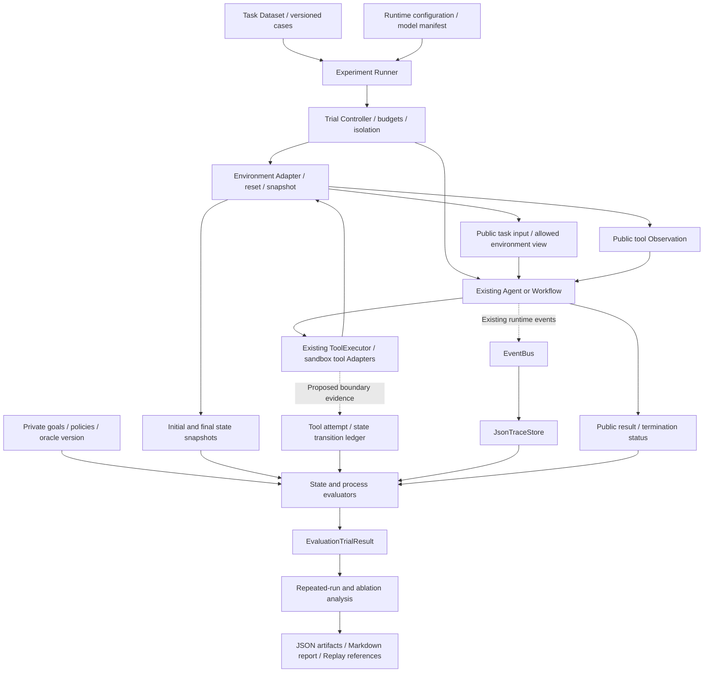

# AgentOS v2.0 Evaluation Runtime Architecture

状态：架构提案，尚未实现。本文为 Step 24 设计文档，不修改 Agent Core、Planner 协议、Model Interface、Tool Runtime 或现有 Evaluation API。

研究定位：**Reliability-Oriented Runtime Kernel for LLM Agents**。目标从“证明 Agent 可以运行”转向“量化 Agent 是否可靠，以及哪些 Runtime 机制改善可靠性”。

## 1. Motivation

传统 Demo 验证链路是：

```text
Input → Agent → Final Answer → Text Comparison
```

文本匹配可以证明某次输出符合预期，却不能证明目标动作真正发生。Agent 可以声称修改成功但环境没有变化，也可以通过不同的合法工具路径完成同一目标。

需要澄清：AgentOS v1 Evaluation 并非只有文本匹配。当前已经结合 Trace 统计工具序列、Workflow 完成、重试、校验失败和延迟；但任务成功主要依赖最终答案精确匹配，工具选择主要依赖预设序列。因此它适合 Demo、机制测试和回归检查，尚不足以全面衡量：

- 工具选择是否符合当前环境状态，而非仅匹配一条参考路径。
- 参数是否语义正确，而非仅通过类型与 schema 校验。
- 多步骤执行是否保持约束、达到实际目标。
- 故障发生后是否恢复，以及恢复是否引入额外损害。
- 同一任务在多次独立运行中是否稳定完成。

提出 **State-based Agent Evaluation**：目标状态由可信环境快照和独立规则判断，Trace 用于评估执行过程，重复试验与消融用于研究 Runtime 机制的收益。

τ-bench 使用领域工具、政策约束和模拟用户交互，通过对比最终数据库状态与目标状态评价任务，并以 pass^k 研究多次运行一致性。AgentOS 借鉴这些评估思想，但不声称已经接入该基准或复现其结果。[τ-bench 原始论文](https://arxiv.org/abs/2406.12045)。

## 2. Evaluation Architecture



控制路径是 Runner → Trial → Agent/Environment；评估路径在执行后读取证据。Oracle 不参与模型规划，不把目标快照、隐藏断言或参考工具轨迹放入 prompt。公开业务政策可以进入任务输入，私有评测断言则不能泄露。

Environment Adapter 是隔离的测试环境，不是新增生产数据库依赖。初期可使用进程内状态；现有工具执行接口保持不变，通过注册专用工具 Adapter 操作该环境。

EventBus 与 Trace 仍为旁路。采集失败不能改变 Agent 行为，但会影响可评估性：缺失过程证据标记 unknown，不把缺失日志解释为没有失败。状态快照和评测结果使用独立证据包，不强制扩充现有 Trace 格式。

### Component responsibilities

| 组件 | 职责 | 不承担的职责 |
| --- | --- | --- |
| Task Dataset | 输入、初始状态、目标谓词、允许动作、故障方案 | 生成 Agent 的参考答案作为提示 |
| Experiment Runner | 装配配置、任务、重复次数与输出目录 | 修改执行循环或自动选择最佳结果 |
| Trial Controller | 隔离、预算、终止、快照和清理 | 在 Agent 失败后偷偷执行补救工具 |
| Environment Adapter | 确定性重置、工具操作、状态快照 | 相信 Agent 自报的执行结果 |
| State Evaluator | 独立检查目标与保护约束 | 用最终文本替代环境状态 |
| Process Evaluator | 检查调用、参数、状态迁移与恢复证据 | 将任意不同参考路径判为错误 |
| Reliability Analyzer | 多次运行与配置比较 | 从单条 Trace 推断因果收益 |

## 3. Task and Environment Contracts

以下名称均为未来数据契约，不是已存在的 API。

### EvaluationTask

建议字段：task_id、dataset_version、public_input、environment_type、initial_state_ref、goal_predicates、invariants、allowed_tools、budgets、fault_plan、tags、oracle_version。

目标使用声明式、类型化谓词，例如 equals、contains、unchanged；不执行任务文件中的任意 Python、eval 或 shell。复杂判断由可信、版本化的 OutcomeChecker Adapter 实现。每个任务指定比较字段，避免时间戳等无关变化造成误判。

示例：模拟库存调拨，而非仅检查“调拨成功”的文本：

```json
{
  "task_id": "inventory_transfer_001",
  "public_input": "将仓库 A 的 3 个 widget 转移到仓库 B",
  "initial_state": {"stock": {"A": 10, "B": 2}},
  "goal_predicates": [
    {"path": "stock.A", "operator": "equals", "value": 7},
    {"path": "stock.B", "operator": "equals", "value": 5}
  ],
  "invariants": [
    {"name": "total_stock_conserved"},
    {"name": "stock_never_negative"}
  ],
  "allowed_tools": ["inspect_stock", "transfer_stock"],
  "tags": ["stateful", "multi_step"]
}
```

该领域与工具仅为设计示例，当前项目未实现。目标成功要求终态正确且全过程约束成立；先破坏状态再修复终态不能抹除违规。重复执行 transfer 即使文本正确也会失败。合理的直接调拨或先查询再调拨均可接受，除非公开业务政策明确要求先查询。

Calculator 继续作为兼容回归任务，但返回 56088 本身不是有状态环境评估的充分展示。

### Environment Adapter

拟提供 reset(initial_state)、snapshot()、tool_adapters()、close()。状态由环境持有，不由模型、Trace 或 AgentState.history 持有。快照包含 schema/environment 版本和 revision；执行前后快照应不可变。

每个 trial 创建独立环境、AgentState、模型会话和输出命名空间。多进程或异步并发需要额外证明隔离；初期采用顺序执行。预算终止后必须确认操作已停止再冻结快照，无法确认静止状态时标记评测错误，不评分为普通任务失败。

多轮用户模拟是可选的后续 Session Driver。它在外层调用现有 Agent API，需显式管理公开会话上下文；当前单次 Agent.run 不因此自动获得多轮会话能力。

## 4. Execution and Evidence Lifecycle

```text
Pin manifest → Reset environment → Verify initial state
→ Run Agent with bounded budgets → Stop and confirm quiescence
→ Capture final state → Evaluate goals and process
→ Persist trial artifacts → Aggregate all scheduled trials
```

TrialManifest 关联 experiment_id、config_id、task_id、trial_id 与实际 run_id。未来多轮试验可能关联多个 run_id，不能把一个 run 等同于所有试验。

证据包建议包含：

- manifest：Git revision、模型/后端版本、提示模板摘要、工具契约版本、生成配置、预算、cache 策略、支持时的 seed。
- initial/final snapshot：合成环境状态或经授权的最小状态投影。
- execution ledger：attempt_id、工具名、契约判定、环境 revision、操作状态及结构化失败类别。
- trace_ref：原有 JSON Trace 和 Replay 可读取的关联 ID。
- outcome：目标、约束、证据完整性与终止原因分别记录。

现有核心 Trace 默认不包含参数和 Observation 正文，无法单独证明参数语义或终态。未来工具/模型边界的测试 Adapter 可以采集必要证据，但拒绝发生在 ToolExecutor 之前的调用需另有可信采集点；没有证据时不能编造分母。

采集原始参数仅限合成或明确授权的测试数据；默认报告只展示分类、计数和引用。禁止保存隐藏思维链、API Key 或私人模型输入。Replay 只读展示已记录内容，不是重新执行工具的实验引擎。

## 5. State and Process Scoring

每个 trial 至少区分三个结果轴：

1. goal_satisfied：终态是否满足目标。
2. process_compliant：全过程是否遵守强制政策与保护约束。
3. termination：completed、runtime_error、timeout、step_limit 或 evaluation_error。

主要 trial_success 定义为合法终止、goal_satisfied=true 且 process_compliant=true。即便终态已经满足目标，超时或未完成也不进入主成功指标；单独报告目标达成状态，避免丢失信息。

| 指标 | 建议定义与分母 |
| --- | --- |
| State task success rate | trial_success / 可完整评分的 trials；另报告全部计划 trials 的保守成功比例 |
| Tool selection validity | 在当时状态满足允许工具及前置规则的选择 / 有完整调用证据的选择 |
| Argument contract validity | 满足 schema 的候选调用 / 已观测候选调用 |
| Argument semantic validity | 满足领域前置条件的参数 / 可进行领域判断的调用 |
| Multi-step completion | 成功完成目标及阶段约束的多步骤 trials / 可评分多步骤 trials |
| Recovery success rate | 可恢复故障后仍成功的 trials / 实际触发预声明可恢复故障的 trials |
| Unsafe transition rate | 违反保护约束的状态迁移 / 可观测状态迁移 |
| Cost | trial 总延迟、p95、真实后端请求、重试、工具尝试及实际可得的 token 用量 |

强制规则按状态与允许迁移判断，而不是要求唯一工具序列。相同终态仍需要检查授权、禁止动作和中间状态。不可恢复故障与未触发故障不混入恢复率；被验证器拦截的错误提议与实际执行违规分别统计。

没有调用、没有故障或缺失证据的比例返回 N/A 并展示 coverage，不随意记为 0% 或 100%。环境初始化、Oracle 故障与采集故障标记 evaluation_error；Agent/backend 实际运行错误按实验协议记为失败。基础设施排除必须预先声明并报告数量，不能靠删掉失败 trial 提升成功率。

## 6. Repeated-run Reliability

单次试验包含有界内部 retry；重复试验是完全重置后的独立 Agent 执行，两者不能混淆。默认每个任务在每个配置下运行固定 n 次，禁止只保留最好的一次。

对任务 i，n 次完整评分结果中有 s_i 次成功：

```text
Task success estimate: p_i = s_i / n
All-k-success estimate: choose(s_i, k) / choose(n, k), n >= k
```

后者表示从已完成试验抽取 k 次均成功的一致性估计；它不是“至少一次成功”的 pass@k。按任务等权聚合并报告 k、n、覆盖数与区间；有未知结果的任务单列覆盖/保守结果，不默认为失败或成功再套公式。若宣称 τ-bench pass^k，则必须核对并固定其完整官方评估协议；自定义结果明确命名为 AgentOS all-k consistency。

固定模型 revision、温度等设置，并在支持时记录 seed；seed 不保证后端确定性。真实模型、FakeModel 机制测试与故障注入实验分别报告。共享 cache 可能让重复运行失去独立性，可靠性主实验默认关闭跨 trial 响应缓存，性能实验另行研究 cache 开关。

## 7. Runtime Mechanism Ablation

研究问题不是“完整版本成功率高不高”，而是契约、Parser、Validator 和 Retry 分别产生什么影响。

建议实验配置：最小结构化提示、工具契约提示、Parser normalization、Validator、bounded Retry、完整组合。使用累加与 leave-one-out 两类比较，所有关闭校验的试验仅在无外部副作用的沙箱运行。

- 固定任务、模型、工具与环境版本；随机化配置执行顺序，控制服务漂移。
- 同时提供预算匹配与策略自然预算结果；retry 带来的额外请求必须计入成本。
- 使用独立开发集调参，冻结后在 held-out 任务集评测。
- 按任务做配对比较，报告成功率差值和任务级聚类 bootstrap 区间，避免把同任务大量重复当成独立任务。
- 记录错误接受、错误拒绝、修复成功和预算耗尽；Validator 也可能拒绝合法路径。
- 无法通过随机化/控制消除差异时只陈述关联，不从 Trace 推断因果。

报告应回答“提高多少、在哪些任务、代价是什么、哪些失败未解决”，不以个别 Calculator 成功推导通用可靠性。

## 8. Failure Analysis and Reporting

拟区分 parsing、contract、semantic_validation、planning、tool_execution、transport、budget、environment 和 evidence_gap。记录首次错误、后续恢复与终态，不用单一末尾异常覆盖全部经历。

当前 validation_failure_rate 将可见 PlannerOutputError 证据合并，不能精确区分解析与语义校验。细粒度分类需要未来测试边界采集或公开阶段事件；在证据不足时保留 unknown，不反推隐藏推理。

报告产物拟包括 experiment_manifest.json、trial_results.json、evaluation_report.md 与 Trace/证据引用。Markdown 展示状态成功率、约束违规、覆盖、重复一致性、延迟/请求成本、恢复统计和消融比较。正文与私人状态不默认进入报告。

StateEvaluator 与现有 Evaluator 分层共存，使用新的版本化结果类型，不偷偷改变现有 task_success_rate 的精确答案语义。旧 benchmark cases 保留兼容模式，只有具备状态与 Oracle 的任务进入 state-based 指标。

## 9. Implementation Boundaries and Roadmap

| 状态 | 内容 |
| --- | --- |
| 已实现 v1.x | Agent/Workflow、模型与工具 Adapter、Parser/Validator/Retry、EventBus/Trace、RuntimeMetrics、文本/工具序列 Evaluation、只读 Replay |
| 本文拟设计 v2.0 | Task/Environment 合约、独立 StateEvaluator、Trial/Experiment 编排、证据包、重复一致性与配置比较 |
| 后续研究 | v2.1 细粒度 Failure Analysis，v2.2 Reliability Ablation，v2.5 Memory Runtime，v3 Embodied Agent |

v2.0 建议分阶段实施：

1. 设计并测试纯状态谓词、Oracle 版本与手工构造状态案例；不依赖模型。
2. 实现隔离进程内环境和确定性 FakeModel trial，覆盖重置、重复调用、错误终态及约束违规。
3. 组合既有 Trace/Evaluation，明确证据缺失、超时终止和报告分母。
4. 增加重复运行编排与冻结的真实 MiniLLM 实验配置，不自动启动服务。
5. 输出可复现基线，为后续故障分析和消融提供数据，而非提前宣称机制有效。

验收必须覆盖：终态正确但文本不同、文本正确但终态错误、合理替代工具路径、参数类型正确但语义错误、恢复后违规仍保留、幂等/隔离、缺失 Trace、Oracle 失败、缓存污染和 trial 清理。

本步骤只提供设计，没有新增源代码、API、任务实现、实验结果或 τ-bench 分数。设计依据见 [Research Direction](research_direction.md)、[v1 Evaluation](evaluation.md)、[Trace Replay](replay.md) 与 [v1 Architecture Review](v1_architecture_review.md)。
