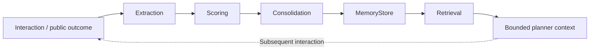
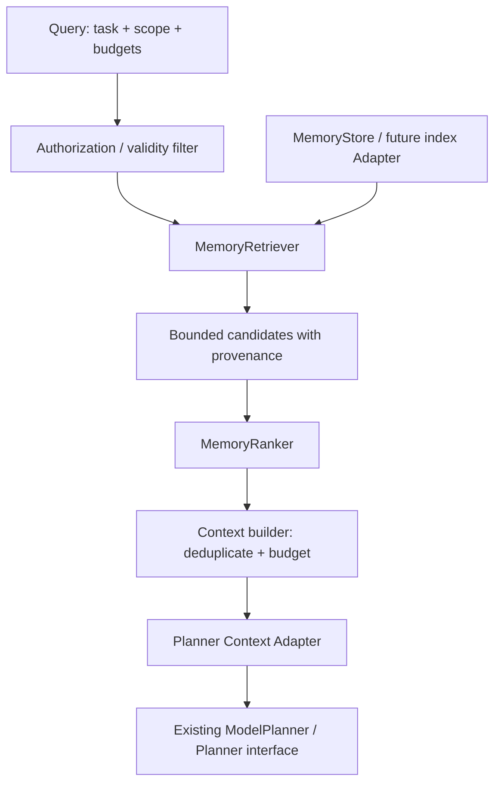

# AgentOS v2.0 Memory Intelligence Architecture

本文是 v2.0 的架构设计提案，不代表功能已经实现。当前基线是 v1.x 的 MemoryStore、JsonMemory、MemoryManager 与 NPCMemory；本次只新增文档，不改变 Runtime、Planner、API 或存储格式。

## 1. Problem Statement

v1 Memory 已提供结构化记录的 CRUD、JSON 持久化、按 type 查询，以及玩家交互状态管理。这解决了“保存什么、存在哪里”的基础问题，但还没有解决“什么值得记住、何时使用、是否可信”。

主要限制：

- MemoryItem 只有 id、type、content、created_at，没有统一的来源、作用域、有效期和事实状态。
- query 只做类型过滤，不能根据当前任务检索或排序相关记忆。
- AgentState.history 属于单次运行；长期存储不会自动进入 Planner 上下文。
- 缺少提取、去重、冲突处理、失效、遗忘及经验整合机制。
- NPC Profile 是状态快照，无法表达玩家经历、关系变化的依据及可撤销的个性化偏好。
- 通用 content 字典没有自动隐私约束；JsonMemory 的线程锁不等于多进程事务或索引一致性保证。

v2 的目标是在存储之上增加独立 Memory Intelligence Layer：提供有来源、受权限约束、预算可控的上下文，并用 Evaluation 验证收益。非目标是替换 Agent Loop、把 Trace 当作知识库，或把模型生成内容直接视为事实。

## 2. Memory Model

三类记忆是逻辑职责，不要求三种数据库。

| 类型 | 内容与用途 | 生命周期 | 初期实现方向 |
| --- | --- | --- | --- |
| Working Memory | 当前任务、公开 Observation、临时上下文与选中的记忆引用 | 单次 run 或有边界的会话；默认不持久化 | 应用维护的有界快照，与 AgentState 保持分离 |
| Episodic Memory | 已发生的交互或执行经历，包括公开结果、失败状态和来源 | 按应用保留策略持久化 | 结构化事件摘要，不复制完整 Trace 或原始媒体 |
| Semantic Memory | 已确认的事实、偏好及有适用范围的经验 | 可更新、撤销、过期和删除 | 带证据的结构化命题，不直接固化模型猜测 |

Working Memory 可以读取 AgentState 的公开状态，但不能成为第二份执行状态来源。Episodic Memory 中的工具失败应保留失败标记，不能成为“成功经验”；Semantic Memory 的偏好也不应仅由一次行为推断。

### Proposed record envelope

拟新增独立的 MemoryRecord，而非直接替换现有 MemoryItem。建议字段：

- id、kind、schema_version、content：标识、类别、格式版本与受约束内容。
- namespace、subject_id：应用与用户/玩家作用域，不以全局玩家 ID 混合不同应用数据。
- source_refs：公开交互 ID、run_id、事件引用或用户确认记录；不存隐藏思维链。
- created_at、updated_at、expires_at：UTC 时间与保留期限。
- status：candidate、active、superseded 或 revoked；只有 active 且未过期的内容可进入上下文。
- confidence、importance：有界分数及其依据，区分证据可信度与业务价值。
- revision、supersedes_id：更新版本与被替代记录，支持冲突审计。

初期可由兼容 Adapter 将 envelope 编码在 MemoryItem.content 中。v1 NPC Profile 不自动解释为语义事实；迁移必须显式选择、校验并保留来源。旧 JSON version 与新记录 schema_version 是不同层级的版本。

## 3. Memory Lifecycle



| 阶段 | 输入与输出 | 必须满足的边界 |
| --- | --- | --- |
| interaction | 已授权的结构化事件、公开结果 | 过滤原始图片、音频、生物特征和无必要的敏感文本 |
| extraction | 从允许字段生成候选记录 | 先规则提取；未来模型提取也必须验证，候选不等于事实 |
| scoring | 计算证据质量、重要性与保留优先级 | 低可信候选不能仅凭高相关性进入长期知识 |
| consolidation | 去重、确认、合并或替代记录 | 保留证据；冲突不能仅靠“最后写入获胜”消除 |
| retrieval | 读取授权、有效、相关的记录 | 先作用域过滤，再排序和预算裁剪 |

用户明确更正优先于推断；相互矛盾且无法确认的命题保留冲突状态或排除，不静默合并。经验整合只接受有验证结果的公开经历，并记录适用条件，不能把一次成功泛化为通用规则。

生命周期还包括过期、撤销和删除。删除应清除正文、派生索引、上下文缓存与派生事实引用，审计只保留必要且不泄露正文的元数据。无法处理删除的 Adapter 不应宣称支持完整生命周期。

重复交互通过 namespace + interaction_id 的幂等键防止重复计数。初期限定单进程顺序写入；涉及多个记录或索引的更新要有可恢复提交状态，不能假设现有 JSON save 已提供事务。

## 4. Retrieval Architecture



Query 包含任务文本、namespace、subject_id、允许类型、时间范围、候选上限、上下文预算和截止时间。权限范围由可信应用提供，模型不能自行扩大查询范围。

Retriever 初期使用结构化字段、关键词和时间过滤；不要求 embedding 或向量数据库。Ranker 对已经授权的候选排序，综合相关性、时效、证据质量和重要性。权重应可配置并通过测试集校准；过期、撤销或越权记录直接排除，而非降分。

Context builder 去重并保留来源、冲突状态和排序理由，输出有界 MemoryContext。上下文预算应同时限制记录数与字符数；只有配置了模型对应 tokenizer 时才能声称精确 token 预算。

记忆文本是不可信数据，不是系统指令。上下文使用明确的数据边界，禁止将存储的“忽略规则”等文本作为工具权限或高优先级指令；分隔文本本身不能完全阻止 prompt injection，仍须沿用工具契约与 Validator。

### Planner integration and fallback

未来通过实现现有 Planner 协议的外层装配器检索上下文，再交给支持 MemoryContext 的 prompt 构造 Adapter。不得修改 user_input 来伪装记忆，也不得把检索结果追加为真实 Observation。Agent Core 与 Decision 不需要认识 MemoryRecord。

普通超时、索引不可用或空结果可按策略降级为无记忆运行，并记录状态。权限无法确认时禁止提供记忆；若应用要求强制记忆依据则应明确失败，而不是静默降级。持久化失败不阻止普通 Agent 回答，但不能向用户声称“已经记住”。

拟新增 memory.extraction.*、memory.consolidation.*、memory.retrieval.* 和 memory.ranking.* 旁路事件。事件默认只记录 run_id、数量、耗时、策略版本和错误类型，避免 Query 与正文落盘；记录 ID 也应按隐私策略处理。

## 5. API Design

以下 Python 签名仅是接口草案，不是已存在的 API。

```python
class MemoryRetriever(Protocol):
    async def retrieve(self, query: MemoryQuery) -> list[MemoryCandidate]: ...

class MemoryRanker(Protocol):
    async def rank(
        self, query: MemoryQuery, candidates: Sequence[MemoryCandidate]
    ) -> list[RankedMemory]: ...

class MemoryLifecycle(Protocol):
    async def extract(self, interaction: MemoryInteraction) -> list[MemoryRecord]: ...
    async def score(self, candidates: Sequence[MemoryRecord]) -> list[ScoredMemory]: ...
    async def consolidate(
        self, candidates: Sequence[ScoredMemory]
    ) -> ConsolidationResult: ...
    async def forget(self, request: ForgetRequest) -> ForgetResult: ...
```

配套数据契约：

| 类型 | 主要字段或职责 |
| --- | --- |
| MemoryQuery | 查询内容、可信作用域、允许类型、时间限制、预算、deadline |
| MemoryCandidate | record、匹配证据；不宣称已经排序 |
| RankedMemory | candidate、score、公开 reason_codes、排序策略版本 |
| MemoryInteraction | interaction_id、作用域、公开事件/结果引用、允许提取的字段 |
| ScoredMemory | 候选、可信度、重要性、保留建议及依据 |
| ConsolidationResult | 新增、替代、拒绝、冲突的 ID，以及提交是否完成 |
| MemoryContext | 裁剪后的记录与来源、预算使用量、降级状态 |
| ForgetRequest / ForgetResult | 可信作用域、删除目标、派生内容清理状态及失败列表 |

MemoryLifecycle 的整合实现通过 MemoryStore 写入，不让 Retriever/Ranker 依赖 JsonMemory。读取与排序不偷偷改变关系分数或持久状态。MemoryStore 的同步 v1 接口保持兼容；异步编排不代表文件 I/O 自动非阻塞，未来 Adapter 必须明确线程卸载与并发策略。

错误应分为权限、非法记录、存储、检索超时和整合冲突，不泄露底层路径、私人正文或 Provider 异常。返回列表遵循稳定排序与候选上限，支持确定性离线测试。存储扫描适合小规模基线，大规模索引属于后续 Adapter 优化。

## 6. Spatial AI NPC Integration

```text
PerceptionEvent → Interaction Adapter → Working Memory
                         ↓                    ↓
               Episodic extraction     Retrieval / Ranking
                         ↓                    ↓
               Relationship / preference   Planner Context
                         ↓                    ↓
                    MemoryStore       Agent → NPCAction
```

- Relationship memory：关系等级是应用定义的状态，不是模型对玩家人格或情绪的判断。变更应有事件依据、有界增量和幂等更新；兼容现有 NPCMemory，而非再维护一份互相冲突的关系值。
- Player experience：记录经授权的结构化经历，例如一起完成任务、上次交互结果、失败后恢复；保存事件来源，不保存原始媒体或整段语音。
- NPC personalization：优先使用明确确认的称呼、语言和交互偏好。行为推断先作为待确认候选，并允许玩家查看、更正、关闭或删除。

例如 player.wave 可形成一次交互经历，但不能单凭挥手推断“玩家喜欢亲密互动”。跨 NPC、跨场景共享必须显式授权；player_id 使用应用分配的标识，不通过人脸或声音识别生成。

若环境没有 Action 执行反馈，只记录“已生成/已发送动作”，不能记为“动作成功完成”。Unity、Camera、Microphone 和真实传输仍在外部 Adapter，Memory Intelligence 不新增引擎依赖。

## 7. Implementation Roadmap

以下是建议里程碑，不是已经发布的版本或日期承诺。

| 版本 | 范围 | 验收门槛 |
| --- | --- | --- |
| v2.0.1 | MemoryRecord、作用域、来源、保留策略与 v1 兼容编码 | 旧数据不被自动改写；序列化、授权隔离、迁移回滚测试通过 |
| v2.0.2 | 确定性 Retriever、Ranker 与预算裁剪 | 检索正确性、稳定排序、过期过滤、空结果与超时降级测试 |
| v2.0.3 | MemoryContext 与 Planner 外层装配 | Agent Loop/协议不变；上下文预算及不可信记忆测试；无记忆回归保持通过 |
| v2.0.4 | 规则提取、评分、去重与保守整合 | 幂等、冲突、来源保留、部分提交恢复、撤销与删除传播测试 |
| v2.0.5 | NPC 经历、关系依据、明确偏好 | 玩家隔离、重复事件、动作反馈、更正与退出个性化测试 |
| v2.0.6 | Memory Evaluation、Trace / Replay 元数据 | 记忆开关对照实验、隐私检查、检索覆盖和失败原因报告 |

评估应复用现有 Evaluation 与 Benchmark，另增加检索 precision/recall、上下文预算、记忆命中覆盖、错误记忆使用率与访问隔离测试。比较任务成功率、工具准确率、延迟及重试成本时固定任务集和模型配置；真实模型实验报告样本数量，不把 FakeModel 成功率解释为泛化能力。

后续再评估可替换索引、语义检索和模型辅助经验整合。它们需要独立契约与证据，不作为初期 Memory Intelligence 的必需依赖，也不以引入向量数据库代替生命周期设计。

设计基础：[v1 Architecture Review](v1_architecture_review.md)、[Design Principles](design_principles.md)、[NPC Integration](npc_integration.md)、[Evaluation](evaluation.md) 和 [Replay](replay.md)。
